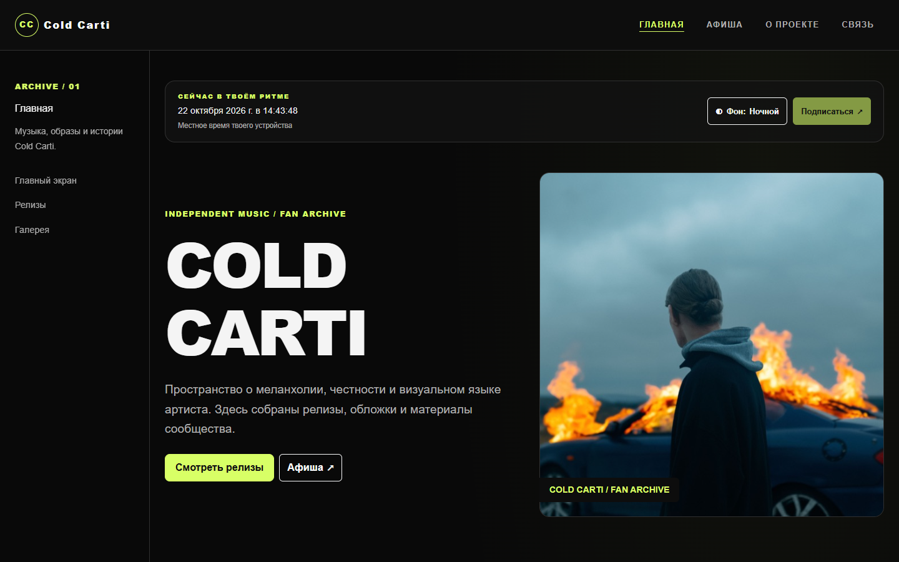
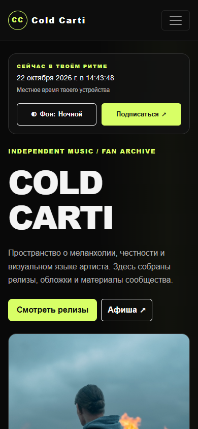

# Music Band - Cold Carti Fan Archive

A responsive fan website built with HTML, CSS, JavaScript and local Bootstrap files.

**Website:** [Live demo](https://kanatovs.github.io/music-bandv3/)

**Team:** Kanatov Sabyrzhan and Zhaxylyk Alikhan, SE-2501

## Pages

- `index.html`: releases, cover carousel and a gallery with a year filter.
- `tour.html`: demonstration concert cards.
- `about.html`: project information, team and FAQ.
- `contact.html`: contact form with JavaScript validation.
- `media-queries.html`: standalone responsive release selection.

## Team contributions

| Member | Main pages | Components to explain and maintain |
| --- | --- | --- |
| Kanatov Sabyrzhan | `index.html`, `contact.html` | Release grid, carousel, gallery filter, form validation, password confirmation and subscription popup |
| Zhaxylyk Alikhan | `tour.html`, `about.html` | Responsive concert cards, visual concept, team information, FAQ accordion, background controls and live clock |

The standalone `media-queries.html` page is shared work. Both names and the group remain in every page footer. The main pages and `site.js` also identify responsibilities for studying the code.

## Assignment 4

- The contact form checks required fields, email, password length and matching passwords. Errors appear beside the fields.
- FAQ answers start closed and open or close when their question is clicked.
- A Subscribe button opens a popup. The close button, outside click and Escape close it.
- The background button cycles through four colors.
- The current date and time update every second.

Shared controls are available on the four main pages. The contact password must contain 8-72 characters without whitespace. Forms are local demos: they do not send or save data or create accounts. Use invented values. Concert dates and ticket statuses are examples; the site does not sell tickets.

The current assignment report is available as [PDF](report/REPORT.pdf) and [editable HTML](report/REPORT.html). [Code study notes](docs/assignment-notes.md) explain the layout, interaction flow and small practice exercises.

## Run locally

Open `index.html` after downloading the project, or run this command in its folder:

```bash
python -m http.server 8000
```

Then open [localhost:8000](http://localhost:8000/). No build or package installation is needed to view the site. Bootstrap and cover images are local; opening external music services requires internet access.

## Checks

Python 3.12 and Node.js 22 are used by CI. Playwright is a development dependency only:

```bash
node --check site.js
python checks/check_site.py
npm ci
npx playwright install chromium
npm test
```

On Linux, use `npx playwright install --with-deps chromium` when browser system libraries are missing. To use an installed Microsoft Edge instead, set `TEST_BROWSER=msedge` in your shell before `npm test`.

GitHub Actions runs these checks on pushes and pull requests. Static checks cover paths and case, fragment IDs, labels, image alternatives, footer credits, documentation resources and nine cover checksums. Browser checks cover five pages at widths of 320, 390, 768, 992 and 1440 pixels, gallery filters, form validation/reset/no transmission, mobile navigation, FAQ, popup controls, background changes, clock updates and the no-JavaScript fallback. Firefox and Safari are not covered.

To regenerate the previews, set `SCREENSHOT_DIR=docs/screenshots` before `npm test`.

## Screenshots





## Hosting and assets

GitHub Pages is configured to serve the root of `main`. Keep `.nojekyll` in the project root. All site paths are relative so the published project also works under `/music-bandv3/`.

Cover images belong to their rightsholders; sources are listed in `assets/covers/sources.json`. Bootstrap license notes are in `assets/vendor/bootstrap/`. This is an unofficial educational fan project.
